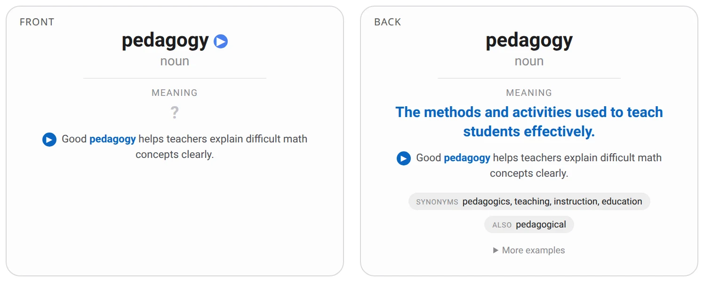
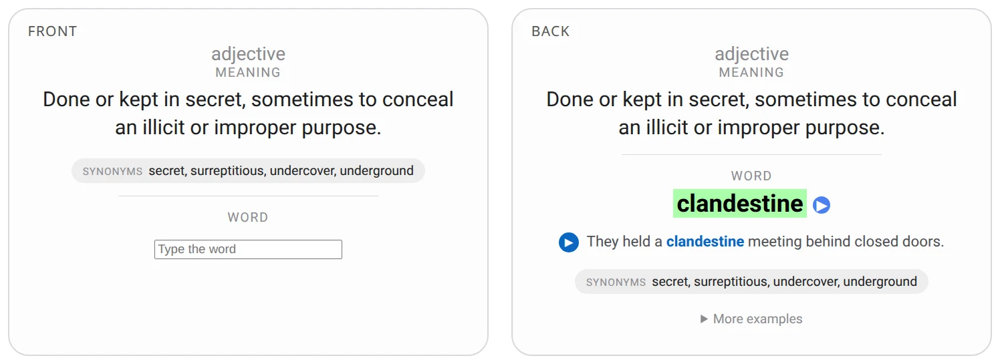
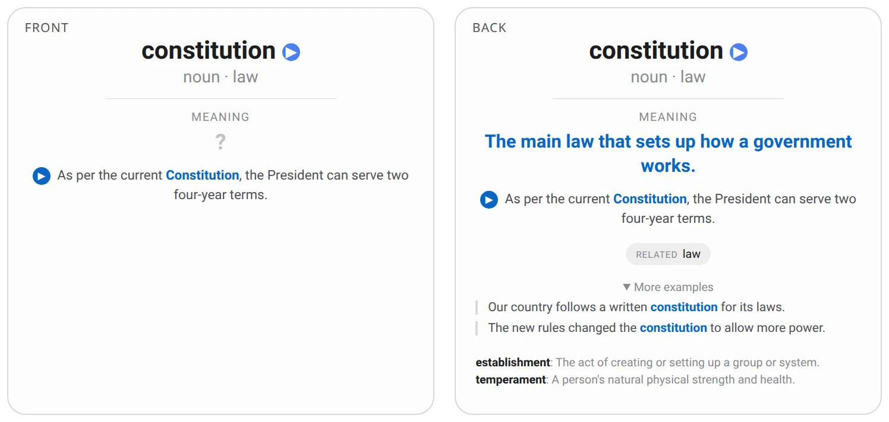

# Lurch

Build your own Anki vocabulary deck from a list of English words. Every card is one *meaning* of a word, not
the word itself, so words like *constitution* get a card for each meaning. Each card has a plain definition,
synonyms or related words, an example sentence (more of them under "More examples"), and a spoken word and
sentence.

Everything is built from open data, and the word list is a plain text file, so anyone can make a deck of their own.

## Quick start

Requires [uv](https://docs.astral.sh/uv/).

```sh
uv sync
cp words.example.txt words.txt
uv run lurch build
```

Edit `words.txt` first: one word per line, `#` starts a comment. The deck is written to
`build/english_vocabulary.apkg`; open it in Anki (File → Import).

`words.txt`, `data/` and `build/` are git-ignored, so your list and your deck stay on your machine.

The first run downloads about 7 GB of models and data (WordNet, GloVe vectors, the Tatoeba sentences, four
language models for matching, filtering and reranking, and the Kokoro voice model) and takes a few minutes.
Later runs reuse them.

## Example

`words.example.txt` holds four words: *pedagogical*, *clandestine*, *serendipity* and *constitution*. Building it
(`cp words.example.txt words.txt && uv run lurch build`) gives a deck whose cards look like this.

**Meaning card**: the word, its part of speech and an example; you recall the meaning. *Pedagogical* was folded
into its base word *pedagogy*, which is listed under "Also":



**Word card**: the definition and synonyms as hints; you type the word:



**Several meanings**: *constitution* gets a card per meaning, a small cue says which one it is, and the other
meanings are listed on the back, with further examples under "More examples":



The word is read aloud when a card shows it; a sentence plays only when you press its ▶ button.

## Adding words later

Add words to `words.txt` (one per line) and run `uv run lurch build` again. Words you already built are quick,
because the model answers are cached. Import the new `build/english_vocabulary.apkg` into Anki (File → Import): notes
you already have keep their study progress, and the new words are added.

## Optional: local language models

Without any model the pipeline uses only open dictionary and corpus data, and takes the best-ranked definition
and sentences. With [Ollama](https://ollama.com) you can add two models:

| Variable | Role |
|---|---|
| `LURCH_WRITER_MODEL` | writes a plain definition and three example sentences for every meaning; its text is the default |
| `LURCH_ARBITER_MODEL` | picks the best definition and the best example from the writer's text and the open candidates, over five shuffled votes; an open-data candidate replaces the writer's text only when it wins at least four of the five |

### Setting up the models

1. Install Ollama from [ollama.com/download](https://ollama.com/download) and start it (it serves on `localhost:11434`).
2. Pull the two models ([`qwen3.5`](https://ollama.com/library/qwen3.5) on the Ollama library):

   ```sh
   ollama pull qwen3.5:9b   # writer, 6.6 GB
   ollama pull qwen3.5:4b   # arbiter, 3.4 GB
   ```

3. Enable them: `cp .env.example .env` (it already names these two models), then run `uv run lurch build`.

Any other Ollama model can be used by changing the two variables; `ollama list` shows what you have. The models
are separate from the first-run downloads above and need about 10 GB of disk. On my machine (a 4 GB GPU, so the
9B model partly runs on the CPU) a meaning takes about a minute with both models; a bigger GPU will be faster.
If a model is missing or Ollama is not running, the pipeline prints a warning and continues without it.
The two models are independent: with only a writer its text is used as it is, and with only an arbiter it chooses
between the open candidates. Every model answer is cached in `.cache/llm/`, so rerunning is cheap.

## Configuration

Copy `.env.example` to `.env` to change a setting.

| Variable | Default | Meaning |
|---|---|---|
| `LURCH_VOICES` | eight US Kokoro voices | comma-separated [Kokoro voices](https://huggingface.co/hexgrad/Kokoro-82M/blob/main/VOICES.md); each word and sentence is read by one of them, chosen from a hash of its text |
| `LURCH_DECK_NAME` | `English Vocabulary` | name of the deck and of the output file (`build/english_vocabulary.apkg`) |
| `LURCH_WORDS` | `words.txt` | the word list; `--words PATH` overrides it |
| `LURCH_WRITER_MODEL`, `LURCH_ARBITER_MODEL` | empty | Ollama models, see above |
| `LURCH_OLLAMA_URL` | `http://localhost:11434` | where Ollama runs |

## The cards

Each meaning becomes one note with two cards, styled like the [Ultimate Countries](https://github.com/AminFadaee/Ultimate-Countries)
deck (light and dark):

| Card | Front | Back |
|---|---|---|
| Meaning | the word, read aloud, its part of speech and its example sentence (a ▶ button plays it); you recall the meaning | the definition, the example, chips for synonyms, related words, opposites and the word's other forms, a collapsible list of more examples and the word's other meanings |
| Word | the definition with synonyms and related words as hints; you type the word | your spelling checked, the word read aloud, the example with its ▶ button, and the same details |

When a word has several meanings, a small cue after the part of speech (*noun · law*) says which one it is.

A note has seven fields (`Word`, `Subtitle`, `Definition`, `Sentence`, `Details`, `WordAudio`, `SentenceAudio`) and
none is ever empty: everything optional is gathered into `Details`.

## How it works

`uv run lurch build` runs four steps; each can also be run alone (`senses`, `sentences`, `audio`, `deck`) and
reads the previous step's `data/entries.json`.

1. **Senses.** Takes the meanings from the English Wiktionary (skipping obsolete, historical and wiki-only senses), joins the matching definitions from Simple
   English Wiktionary and WordNet, and keeps the three best supported. A definition built on the word itself
   (*pedagogical*: "of or relating to pedagogy") is replaced by the base word's (*pedagogy*), but only when the word has no sense of its own. The open
   definitions of up to 18 words are ranked by plain wording, length and agreement between the sources. Synonyms come from
   WordNet and from Wiktionary (only common words close in meaning); when there are fewer than two, broader
   terms and related words from GloVe vectors are added.
2. **Sentences.** Collects the open candidates: the examples attached to each meaning in the dictionaries and
   the Tatoeba sentences that a classifier confidently ties to a meaning, minus fragments, quotes, definitions, talk
   about language, explicit content and hard-to-read text. The writer model, if there is one, adds its definition and
   examples; examples that a classifier ties to a different meaning of the same word, or that use the word as another part
   of speech, are dropped, and meanings whose definitions are near-duplicates are merged. The arbiter
   then picks the best definition and example, and the first example becomes the main sentence, with a few
   others kept under "More examples". A meaning without any sentence is dropped, unless it is the word's only one.
3. **Audio.** Speaks the word and its main sentence with Kokoro; the word plays by itself and the sentence on a button.
4. **Deck.** Writes the Anki package.

The `senses` and `sentences` steps print what they changed: words folded into a base word, meanings dropped,
sentences missing.

## Limits

- The choices between near-equal definitions and sentences come from rules tuned on a handful of words, so
  expect some picks you would change.
- Text written by a model is plain but generic ("a clandestine meeting behind locked doors"); it is marked
  `generated` in `data/entries.json`.
- The arbiter is unstable between near-equal candidates, which is why an open candidate must win four votes of
  five to replace the writer's text. Both models are Qwen, so it may favour the writer's style.
- Word-vector neighbours describe a word in general, not one meaning, so they are only used for words with a
  single meaning.
- Words that Wiktionary and WordNet do not know get no card.

## Sources and licences

| Source | Used for | Licence |
|---|---|---|
| [English Wiktionary](https://en.wiktionary.org/), via [kaikki.org](https://kaikki.org/) | meanings, definitions, synonyms, examples | CC BY-SA 4.0 |
| [Simple English Wiktionary](https://simple.wiktionary.org/) | definitions, examples | CC BY-SA 4.0 |
| [Open English WordNet 2024](https://en-word.net/) | definitions, synonyms, broader terms, examples | CC BY 4.0 |
| [Tatoeba](https://tatoeba.org/) | example sentences | CC BY 2.0 FR |
| [GloVe wiki-gigaword-100](https://nlp.stanford.edu/projects/glove/) | related words | PDDL |
| [wordfreq](https://github.com/rspeer/wordfreq) | word frequency | CC BY-SA 4.0 |
| [bge-base-en-v1.5](https://huggingface.co/BAAI/bge-base-en-v1.5), [bge-reranker-large](https://huggingface.co/BAAI/bge-reranker-large), [nli-deberta-v3-base](https://huggingface.co/cross-encoder/nli-deberta-v3-base), [bart-large-mnli](https://huggingface.co/facebook/bart-large-mnli) | matching meanings and sentences, filtering | MIT, Apache 2.0 |
| [Kokoro-82M](https://huggingface.co/hexgrad/Kokoro-82M) | speech | Apache 2.0 |

A deck contains text from Wiktionary and Tatoeba, so share it only with attribution to them and under
compatible terms.
